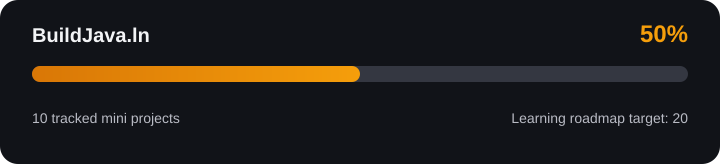

# BuildJava.ln

**A personal log of learning Java through practical exercises.**

BuildJava.ln is a learning repository focused on Java. Each exercise is a small program with its original Java source code and a study guide explaining the concepts being practiced.

The website is deliberately plain. Its only purpose is to explain the repository and provide a direct way to open an exercise. The focus of the project is the Java code, not the website design.

## Current exercises

1. **TypeProfile** — data types and console input.
2. **WeekDay** — selection with switch.
3. **Calculator** — arithmetic and operators.
4. **JoKenPo** — random choices, conditions, and repetition.
5. **LoginIntermediary** — strings, boolean logic, and limited attempts.
6. **bulletin** — classes, objects, and averages.
7. **Vehicle** — constructors and object attributes.
8. **DeveloperProfile** — objects and ArrayList.
9. **library** — collection operations.
10. **CandidateManager** — searching, removing, and menu-driven collections.

The order represents the current learning progression, from beginner fundamentals to intermediate object-oriented programming and collections.

## How to use an exercise

Each exercise has two parts:

- **Study guide:** the Markdown file in the projects/md/ directory.
- **Java implementation:** the original .java file in projects/Beginner/ or projects/Intermediate/.

Open the website's first exercise or navigate directly to another exercise using its project ID:

    project.html?project=TypeProfile
    project.html?project=Vehicle
    project.html?project=library

## Repository structure

    BuildJava.ln/
    ├── .github/
    │   ├── agents/
    │   └── workflows/
    ├── assets/
    │   └── progress.svg
    ├── js/
    │   ├── project-data.js
    │   ├── project-study.js
    │   └── projects.js
    ├── projects/
    │   ├── Beginner/
    │   ├── Intermediate/
    │   └── md/
    ├── scripts/
    │   └── update-progress.mjs
    ├── tests/
    │   └── project-data.test.js
    ├── index.html
    ├── project.html
    └── package.json

## Run locally

Requirements: a modern browser and Node.js 22 or later for checks.

    git clone https://github.com/duartexz-dev/BuildJava.ln.git
    cd BuildJava.ln
    python -m http.server 8000

Open http://localhost:8000. The pages load the study guides and Java source files over HTTP, so opening the HTML files directly from the file system is not supported.

## Quality checks

No third-party Node.js packages are required.

    npm run check
    npm test

The automated tests verify the exercise metadata, ordering, and the existence of every referenced Java source and Markdown guide. They also verify that the landing page remains a simple introduction without a 3D scene or stylesheet.

## Progress indicator

The progress graphic is generated from js/projects.js by scripts/update-progress.mjs. It represents the current status of the learning roadmap. It is not a measure of time spent or lines of code.

## Learning principles

- Practice by writing code.
- Keep the original Java implementation available.
- Explain the concepts being practiced.
- Be honest about what is planned and what is complete.

## License

This project is distributed under the MIT License. See LICENSE.
