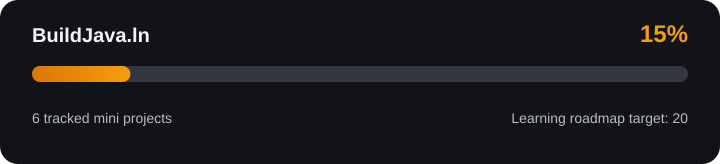

# BuildJava.ln




**Learning Java by building small projects, one step at a time.**

BuildJava.ln is a beginner project that combines a simple website with a growing collection of Java exercises. It is still in an early stage: the site, project catalog, documentation, and deployment setup are being improved as I learn.

> This repository is a work in progress. The roadmap describes ideas and planned learning steps, not 20 completed projects.

The progress bar measures weighted progress across the learning roadmap, not the number or percentage of separate GitHub repositories created. Planned projects count as 0, in-progress projects as 0.5, and completed projects as 1, divided by the 20-project target. The catalog currently tracks four mini projects; their status reflects ongoing work, not completion.

## Contents

- [About](#about)
- [Current Progress](#current-progress)
- [Technologies](#technologies)
- [Repository Structure](#repository-structure)
- [Run the Website Locally](#run-the-website-locally)
- [Java Projects](#java-projects)
- [How the Catalog Works](#how-the-catalog-works)
- [GitHub Actions and Workflows](#github-actions-and-workflows)
- [Roadmap](#roadmap)
- [Contributing and Feedback](#contributing-and-feedback)
- [License](#license)

## About

The goal of BuildJava.ln is to document my progress while learning Java through practical exercises. Instead of only collecting notes, I want to build small programs, explain what each one practices, and gradually organize them in a website.

The website is also a learning project. It uses HTML, CSS, Bootstrap, and plain JavaScript to display project cards and provide appearance settings. I am keeping the implementation simple while I develop my programming fundamentals.

## Current Progress

**Overall status: early development.** The project is not finished, and some features and documentation still need refinement.

| Area              | Current state                                                                               |
| ----------------- | ------------------------------------------------------------------------------------------- |
| Website structure | Basic page and styling are in place                                                         |
| Project catalog   | Displays four Java exercise cards                                                           |
| Java exercises    | Several starter exercises exist; the calculator is unfinished                               |
| Project links     | Some repository links and descriptions still need to be connected or verified               |
| Documentation     | Being revised as the project develops                                                       |
| GitHub Pages      | A Pages deployment has run successfully; the deployment setup should continue to be checked |
| Progress SVG      | Generated from project statuses by `.github/workflows/update-progress.yml`                 |

### Progress labels

- **Planned** — an idea on the roadmap; implementation has not started.
- **In progress** — the project is currently being developed.
- **Completed** — the project is implemented, tested, and documented.

Project statuses are stored in `js/projects.js` and used by the progress SVG generator. They are learning-roadmap indicators, not evidence that separate repositories have been created.

## Technologies

- **Java** — language used for the learning exercises.
- **HTML5** — website structure.
- **CSS3** — layout, responsive styling, and visual themes.
- **JavaScript** — project catalog and interactive behavior.
- **Bootstrap 5 and Bootstrap Icons** — layout utilities and interface icons.
- **Git and GitHub** — version control and source hosting.
- **GitHub Pages** — static website hosting.

The website currently does not require a backend, database, or JavaScript build step. Some external assets, such as Bootstrap and fonts, require an internet connection.

## Repository Structure

```text
BuildJava.ln/
├── index.html          # Main website page
├── styles/
│   └── style.css       # Website styles
├── js/
│   ├── app.js          # Theme and appearance controls
│   └── projects.js     # Project card data and rendering
├── scripts/
│   └── update-progress.mjs # Generates the README progress SVG
├── assets/
│   └── progress.svg    # Generated learning-roadmap progress
├── projects/           # Java exercises
├── README.md
├── LICENSE
└── .gitignore
```

GitHub Actions workflow files normally live in `.github/workflows/`. The repository currently uses GitHub Pages deployment, but a dedicated workflow file for project checks (such as syntax checks or tests) is not yet documented here.

## Run the Website Locally

### Requirements

- A modern web browser.
- Git, if you want to clone the repository.
- Optional: Visual Studio Code with the Live Server extension.

### Steps

```bash
git clone https://github.com/duartexz-dev/BuildJava.ln.git
cd BuildJava.ln
```

Open `index.html` in your browser, or launch it with Live Server in VS Code. No package installation or build command is required for the current static site.

## Java Projects

The website currently displays four entries in `js/projects.js`. The repository also contains Java exercise files, and not all of them should be considered finished projects yet.

| Exercise                | Current focus                                | Progress note                                            |
| ----------------------- | -------------------------------------------- | -------------------------------------------------------- |
| `ReturnName.java`       | Input, conditionals, loops, formatted output | Starter exercise                                         |
| `DrivingCarWallet.java` | User input and conditional logic             | Basic implementation; input validation can improve       |
| `WeekDay.java`          | `switch` statements                          | Basic implementation; invalid input feedback can improve |
| `loginSystem.java`      | Strings, conditions, and limited attempts    | Basic login simulation, not real authentication          |
| `Calculator.java`       | Calculator fundamentals                      | Incomplete starter file                                  |

These are learning exercises, not production-ready applications. In particular, the login exercise only checks simple input rules and does not securely authenticate users or store accounts.

## How the Catalog Works

The current catalog data is stored in `js/projects.js`. Each project is represented by a JavaScript object with fields such as its name, status, category, difficulty, description, concepts, and repository URL. Status must be `planned`, `in-progress`, or `completed`; completed means implemented, tested, and documented.

Example of a catalog entry:

```js
{
  name: "Calculator",
  status: "planned",
  type: "Fundamentals",
  difficulty: "Beginner",
  description: "Build a calculator using basic Java concepts.",
  concepts: ["Scanner input", "Operators", "Conditionals"],
  repoUrl: "https://github.com/duartexz-dev/BuildJava.ln"
}
```

When adding an entry, update the description and link to match code that actually exists. A roadmap idea should not be presented as a completed project. The progress generator reads this array, assigns weights of 0, 0.5, and 1 to planned, in-progress, and completed projects, respectively, and divides the weighted total by the 20-project roadmap target. The resulting percentage is capped at 100%. Run `node scripts/update-progress.mjs` to regenerate `assets/progress.svg`; the script validates project data and leaves the SVG unchanged when its output has not changed.

## GitHub Actions and Workflows

A **workflow** is an automated process that GitHub runs when a defined event occurs. Workflows are written in YAML and are usually stored in `.github/workflows/`. They help reduce repetitive manual steps and make it easier to catch problems before or after code is published.

For example, a workflow can run when code is pushed to `main` or when a pull request is opened. It can check files, run tests, build a site, or publish the result.

The progress workflow runs when project data or its generator changes on `main`, and can also be started manually. It commits the generated SVG only when the file changes. For that push to work, repository administrators must allow read and write workflow permissions in **Settings → Actions → General → Workflow permissions**. The workflow uses the repository-provided `GITHUB_TOKEN`; no personal access token is needed.

### Common workflow terms

| Term                | Meaning                                                            |
| ------------------- | ------------------------------------------------------------------ |
| **Workflow**        | The complete automation described by a YAML file                   |
| **Event / trigger** | What starts the workflow, such as a push or pull request           |
| **Job**             | A group of steps that runs on a runner                             |
| **Runner**          | The machine that executes the job, often an Ubuntu virtual machine |
| **Step**            | One action or shell command inside a job                           |
| **Action**          | A reusable unit of automation, such as checking out the repository |
| **Artifact**        | A file or bundle produced by a workflow, such as a built website   |
| **Deployment**      | Publishing the built website to a hosting environment              |

### How this relates to BuildJava.ln

GitHub Pages has successfully completed a deployment run for this repository. GitHub's Actions tab records the result of that deployment. However, deployment automation and code-quality automation are different things:

- **Deployment workflow:** publishes the static website so visitors can access it.
- **Quality-check workflow:** could later validate Java files, check website files, or run automated tests.
- **Test workflow:** could run tests as the Java exercises become more structured.

At this early stage, the main goal is to keep the static site deployable. A dedicated quality-check workflow is a future improvement, not a feature to claim as already implemented.

### Where to check a workflow

1. Open the repository's **Actions** tab.
2. Select a workflow run to see whether it succeeded or failed.
3. Open the run to inspect each job and step.
4. If a run fails, read the first relevant error in the failed step, fix the cause, and push a new commit.

A green deployment run means that the deployment workflow completed successfully. It does **not** guarantee that every link, card, Java program, or visual detail is correct; those still need to be tested.

### GitHub Pages setup

To review the site's publishing settings:

1. Open **Settings → Pages** in the repository.
2. Check which publishing source is selected.
3. Open **Actions** and inspect the latest Pages deployment.
4. Use the URL shown in the Pages settings to visit the published site.

If the project later adds its own deployment YAML, keep that file under `.github/workflows/` and make sure its trigger, permissions, build path, and deployment steps match the repository's actual structure.

## Roadmap

This roadmap is intentionally small and may change as I learn.

- [ ] Finish the calculator exercise.
- [ ] Improve input validation and error messages in the current Java exercises.
- [ ] Rename `loginSystem.java` and its class to follow Java naming conventions.
- [ ] Make catalog descriptions and repository links match the actual files.
- [ ] Add a screenshot of the website.
- [ ] Review accessibility, responsive layout, and theme contrast.
- [ ] Document how to compile and run each Java exercise.
- [ ] Consider a dedicated GitHub Actions workflow for basic automated checks.

## Contributing and Feedback

This is primarily a personal learning project, but constructive feedback and beginner-friendly suggestions are welcome. If you spot a bug or documentation issue, you can open an issue in the repository.

## License

This project is licensed under the MIT License. See [`LICENSE`](LICENSE) for details.

---

**Learning in public, improving one step at a time.**
