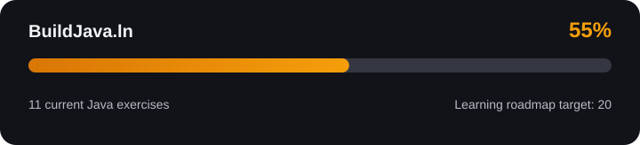

# BuildJava.ln


**A personal Java learning journey built around 20 practical exercises, original code, and detailed study guides.**

[Open the website](https://duartexz-dev.github.io/BuildJava.ln/) · [GitHub](https://github.com/duartexz-dev) · [Instagram](https://www.instagram.com/duarteeo.dev/) · [YouTube](https://www.youtube.com/@duarteeo-dev)



## The idea

BuildJava.ln was created to turn learning Java into a practical, visible process. Instead of keeping notes disconnected from code or following tutorials without building anything, the repository brings each exercise, its original Java implementation, and its explanation together.

The goal is to develop **20 Java exercises**, gradually moving from language fundamentals toward object-oriented programming, collections, and small console applications. The repository currently contains **10 exercises**. The other **10 are still ahead** and will be added as the learning journey progresses.

This is a learning record, not a collection of finished or production-ready applications. The code is allowed to show the stage at which it was written, and each guide explains the implementation that actually exists.

## Progress

- **10 exercises currently catalogued**
- **10 more exercises planned**
- **20 exercises in the overall learning goal**

The 50% indicator measures catalogue progress (10 entries out of 20). It does not claim that every exercise is mastered or that the project is finished.

## The 10 current exercises

| # | Exercise | Main concepts | Level |
| --- | --- | --- | --- |
| 01 | [TypeProfile](./projects/Beginner/TypeProfile.java) | Data types, Scanner, formatted output | Beginner |
| 02 | [WeekDay](./projects/Beginner/WeekDay.java) | switch, selection, input | Beginner |
| 03 | [Calculator](./projects/Beginner/Calculator.java) | Arithmetic, operators, switch | Beginner |
| 04 | [JoKenPo](./projects/Beginner/JoKenPo.java) | Random, conditions, loops | Beginner |
| 05 | [LoginIntermediary](./projects/Intermediate/LoginIntermediary.java) | String comparison, boolean logic, while | Intermediate |
| 06 | [bulletin](./projects/Intermediate/bulletin.java) | Classes, objects, constructors | Intermediate |
| 07 | [Vehicle](./projects/Intermediate/Vehicle.java) | Object state, constructors, toString | Intermediate |
| 08 | [DeveloperProfile](./projects/Intermediate/DeveloperProfile.java) | Objects, ArrayList, enhanced for | Intermediate |
| 09 | [library](./projects/Intermediate/library.java) | ArrayList, input loop | Intermediate |
| 10 | [CandidateManager](./projects/Intermediate/CandidateManager.java) | Methods, collections, menu flow | Intermediate |

The next ten exercises have not been registered yet. They will be defined as the learning sequence develops rather than listed as projects that do not exist.

## How each exercise works

Every exercise has two central files:

- **Java source** — the original program, kept as the main practical work.
- **Study guide** — a Markdown document in `projects/md/` that explains the actual source, its concepts, execution flow, examples, limitations, and possible practice extensions.

The website is intentionally a small index. Each project card shows a description and provides two direct links: one to the study guide and one to the Java source. It does not embed the code, render Markdown into a separate lesson page, or replace the repository files.

## Learning approach

1. Build a small Java program around a specific concept or problem.
2. Understand the source instead of treating a working output as proof of understanding.
3. Document the code in source order, connecting Java syntax to what the program does.
4. Review limitations and improve the solution as knowledge grows.
5. Add the next exercise without losing the history of the previous work.

The project prioritizes practice, clear explanations, and gradual progression over a large interface or unnecessary tooling.

## Run a Java exercise

Requirements: Java 21 or later.

Compile and run CandidateManager:

```console
javac -d out projects/Intermediate/CandidateManager.java
java -cp out Intermediate.CandidateManager
```

Compile and run Calculator:

```console
javac -d out projects/Beginner/Calculator.java
java -cp out Calculator
```

## Run the website locally

Use the VS Code Live Server extension or another local static HTTP server from the repository root. Opening `index.html` directly may prevent the browser from loading the JavaScript modules correctly.

Once the local server is running, open its local address in the browser. The page reads `data/projects.json`; the two links on each card point to the corresponding files in this repository.

## Automated checks

Requirements: Node.js 22 or later and Java 21 or later.

Run the repository checks:

```console
npm run check
npm test
```

The GitHub Actions workflow also compiles the Java exercises and runs smoke tests for selected CandidateManager and Vehicle behaviors. The checks protect catalogue integrity, guide structure, source links, and selected program behavior; they are not a substitute for comprehensive tests of every Java method.

## Repository structure

```text
BuildJava.ln/
├── .github/
│   ├── agents/                 # JavaSage and design workflow instructions
│   └── workflows/
│       └── pages.yml           # Node checks, Java compilation, and deployment
├── assets/
│   └── progress.svg            # README progress bar (10 of 20)
├── data/
│   └── projects.json           # Canonical project catalogue
├── js/
│   ├── project-data.js         # Small JSON catalogue adapter
│   └── landing.js              # Renders project cards and direct file links
├── projects/
│   ├── Beginner/               # Four introductory Java exercises
│   ├── Intermediate/           # Six developing Java exercises
│   └── md/                     # One study guide per exercise
├── styles/
│   └── site.css                # Landing page and project-card styles
├── tests/
│   ├── project-data.test.js    # Catalogue and project-index checks
│   └── study-content.test.js   # Guide structure and direct-link checks
├── index.html
└── package.json
```

## Technologies

| Technology | Purpose |
| --- | --- |
| Java | Main learning content and console exercises |
| Markdown | Study guides and code explanations |
| HTML and CSS | Lightweight project index and cards |
| JavaScript | Reads the catalogue and renders the cards |
| Node.js | Repository validation tests |
| GitHub Actions | Java compilation, smoke tests, and website deployment |

The website is static. It has no backend, database, frontend framework, or runtime AI dependency.

## Project principles

- Java is the main focus; the website exists only to organize access to the exercises.
- Every registered exercise has one source file, one study guide, and one catalogue entry.
- The README and progress graphic reflect the real catalogue, not hypothetical projects.
- Explanations follow the actual implementation, including its limitations.
- The remaining ten exercises will be added as they are developed.

## License

This project is distributed under the MIT License. See [LICENSE](./LICENSE).
